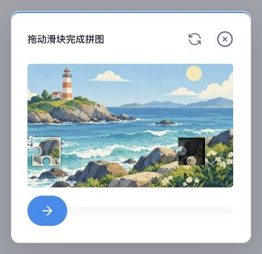
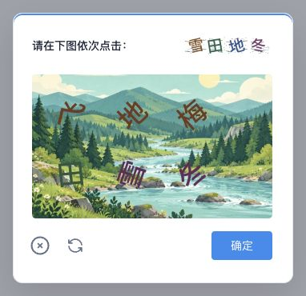
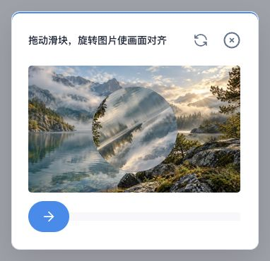
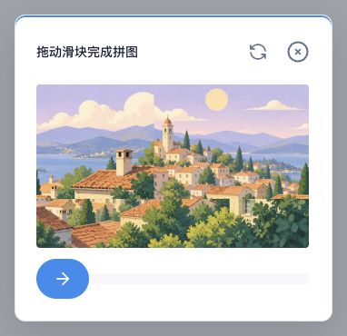
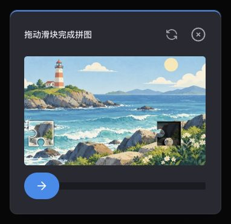
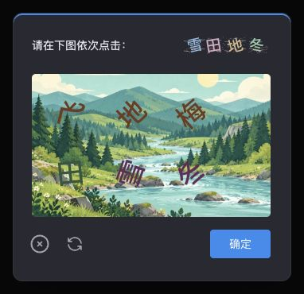
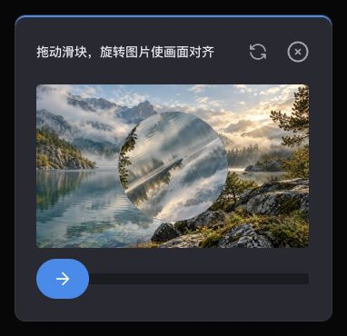
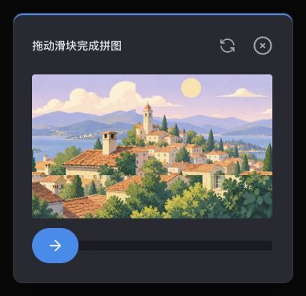

# 苍穹验证码

**Cangqiong CAPTCHA · 纯 PHP/GD 开源验证码**

[简体中文](README.md) · [English](README.en.md)

苍穹验证码是一套独立维护、使用纯 PHP/GD 实现的验证码核心，支持滑块拼图、文字顺序点选、旋转拼图、图片拼接，以及独立的工作量证明（POW）。图像生成和答案校验均在 PHP 中完成，不依赖在线图片服务或第三方验证码平台。

它专注于图像生成和答案校验，不绑定业务框架。HTTP 接口、浏览器界面、会话、存储及登录认证由接入项目负责。

## 效果预览

以下为苍穹验证码接入项目后的**完整弹窗实拍**，包含顶部提示、验证码图片、刷新、关闭及确定按钮／拖动滑轨。图片由本包实际生成，界面使用接入项目的前端 SDK 和主题适配；本 PHP 包不包含这些前端文件。

### 浅色主题

| 滑块拼图 | 文字顺序点选 |
| :---: | :---: |
|  |  |
| **旋转拼图** | **图片拼接** |
|  |  |

### 深色主题

| 滑块拼图 | 文字顺序点选 |
| :---: | :---: |
|  |  |
| **旋转拼图** | **图片拼接** |
|  |  |

另提供 POW 计算验证核心，无图形界面。背景图可替换，示例图片不代表安全强度。

## 能力

- 四种图形题型，共用生成与校验接口。
- 默认单滑块缺口，保留受信任配置控制的可选干扰缺口。
- 服务端生成带随机干扰的点选提示图片，不通过 JSON 下发目标明文或答案坐标。
- 本地随机背景及有界裁切、翻转、亮度变化；可独立替换背景目录。
- 严格检查数值、坐标、事件顺序、图片尺寸及时间边界。
- 无状态 POW 核心，参数和计算量有上限。
- Apache-2.0 开源；PHP 8.4、8.5 有自动化测试。

## 环境要求

PHP 8.4+，GD（JPEG、PNG、FreeType）和 mbstring。浏览器端需接入兼容 SDK；本仓库不包含完整前端，协议兼容基线及第三方前端许可见 [来源与兼容记录](UPSTREAM.md)。

接入项目必须提供私有答案存储、过期机制、会话及用途绑定、限流，以及原子化的一次性校验和凭证消费。

## 安装

Composer 包名为 `xupaoye/cangqiong-captcha`，目前尚未发布该包名的稳定标签，也未上架 Packagist。以下为 main 开发版接入方式；生产应等待稳定标签并审查锁文件。

在接入项目的根 `composer.json` 中加入：

```json
{
  "repositories": [
    { "type": "vcs", "url": "https://github.com/XuPaoYe/cangqiong-captcha" }
  ],
  "require": {
    "xupaoye/cangqiong-captcha": "dev-main"
  }
}
```

```sh
composer update xupaoye/cangqiong-captcha
```

检查并提交 `composer.lock`。生产发布后使用审查过的稳定标签约束，部署执行 `composer install`，不要在生产自动跟随 main。普通公开下载无需私有凭据，但受 GitHub 请求限额影响。

本仓库重新建立了提交历史，尚未发布新标签；旧仓库的历史版本下载不再保证可用。已有应用须显式迁移依赖及锁文件，不能仅修改仓库地址。PHP 命名空间继续使用 `Foundation\Captcha`。

## 图形验证码

```php
use Foundation\Captcha\ImageCaptcha;

$engine = new ImageCaptcha();
$challenge = $engine->generate('SLIDER');

// 仅将 public 返回浏览器。
$public = $challenge['public'];

// answer 仅保存在受信任的服务端存储中。
$answer = $challenge['answer'];

// 根据服务端验证过的挑战 ID、会话及用途取回答案后校验。
$passed = $engine->verify($answer, $submittedTrack);
```

支持 `SLIDER`、`WORD_IMAGE_CLICK`、`ROTATE`、`CONCAT`。题型和容差必须由服务端决定，不能让浏览器挑选更弱的策略或提交自己的答案。

组件不生成图形挑战 ID、不提供 HTTP 端点、不认证用户，也不签发登录凭证。接入方需生成不可预测的 ID、私有保存答案，并将挑战绑定到当前会话和操作。**失败尝试也必须原子作废**，浏览器返回的布尔值不能当作验证凭据。

### 坐标与轨迹

输出图片为 600×360，支持的浏览器显示及轨迹坐标为 300×180；旋转题型横向分母固定为滑轨行程 242px，不能任意缩放坐标。

轨迹包含 `bgImageWidth`、`bgImageHeight`、整数毫秒 `startTime` / `stopTime` 和 `trackList`。每个事件包含 `x`、`y`、`t`、`type`；数值必须为有限 JSON 数字，不接受数字字符串。拖动顺序为 `down`、零个或多个 `move`、`up`；点选允许 `click` 和指针 `move`。总时长限制为 100–120000ms。

上述规则用于拒绝畸形输入，不证明轨迹来自真人。默认只显示一个真实滑块缺口；可通过可信配置 `new ImageCaptcha(sliderDecoy: true)` 开启干扰缺口，但可能影响辨认，普通登录不建议开启。

### 自定义素材

```php
$engine = new ImageCaptcha(
    backgroundDirectory: '/trusted/project/captcha-backgrounds',
    minimumCropUnits: ['portrait' => 138],
);
```

背景目录直接存放 720×432 的 `.jpg` 文件，解码前检查类型和尺寸。裁切配置键为不含扩展名的文件名，值为 120–144 的整数；裁切宽高分别为 `unit × 5`、`unit × 3`。默认 120，138 可保留较完整构图，144 不作空间裁切。目录缺失或为空时拒绝生成，不静默回退。

也可用 `new ImageCaptcha('/trusted/absolute/resources')` 替换包含 `templates/`、`fonts/`、`backgrounds/` 的完整资源目录。素材路径属于受信任的服务端配置，不能直接使用上传目录或请求参数。

内置五张 AI 生成风景图，不含客户数据或业务代码；来源和授权范围见 [背景说明](resources/backgrounds/README.md)。

## POW 核心

```php
use Foundation\Captcha\PowCaptcha;

$pow = new PowCaptcha();
$challenge = $pow->generate(); // 难度 4、盐长度 16、解数量 4
$passed = $pow->verify($challenge['answer'], ['data' => $nonceString]);
```

`track.data` 使用 `-` 连接十进制 nonce。服务端只校验，不执行昂贵求解。难度按十六进制位数计，范围 1–6；盐长度 1–64，解数量 1–16。nonce 必须为规范的无符号 JavaScript 安全整数，拒绝带符号、引号、小数及指数形式。

POW 证明计算成本，不能证明真人，也不能由客户端自行用来替代交互验证。本组件不提供 POW HTTP 端点或完整浏览器 Worker 生命周期。

## 开发与验证

```sh
composer install
composer validate --strict
composer resources:check
composer test
composer audit
```

单独执行固定基线回归（已包含在 `composer test` 中）：

```sh
composer parity
```

开发和测试只需 PHP、所需扩展和 Composer，不需要 Java/JDK 或 Node.js，也不下载参考源码。PHP 测试读取已固化的 2204 个判定输入与预期结果，并比较 24200 个裁切像素；测试数据带 SHA256 校验，来源及维护规则见 [基线说明](tests/fixtures/reference/README.md)。这是固定历史基线回归，不再实时运行原 Java 实现；后续新增规则由苍穹自己的测试维护。

核心测试不能代替接入方的 HTTP、数据库、并发、浏览器和部署验收；本地小样本图像匹配测试已确认滑块可被自动解题，详见 [安全策略](SECURITY.md)；尚无生产环境、OCR 或完整多题型攻防评估。

## 安全与维护

PHP 核心由本项目独立维护，按需审查和吸收第三方修复，不自动同步外部代码。见 [安全策略](SECURITY.md) 和 [更新记录](CHANGELOG.md)。

验证码只是登录防护的一环，不能替代密码认证、会话与账户/IP 限流，也不等于商业风控引擎。漏洞请通过 GitHub **Security → Report a vulnerability** 私密报告，不在公开 issue 中提交生产答案、密钥或可利用细节。

## 许可证与来源

代码及衍生模板采用 [Apache-2.0](LICENSE)。项目包含经开源授权移植和修改的代码及素材；独立品牌和自主维护不表示所有内容均从零原创。原作者署名与来源见 [NOTICE](NOTICE)、[来源记录](UPSTREAM.md)，发布时必须保留。

字体为重新命名的 Noto Sans SC 子集，单独遵循 [SIL OFL 1.1](resources/fonts/NotoSansSC-OFL.txt)。背景图的授权范围以各自素材说明为准。
